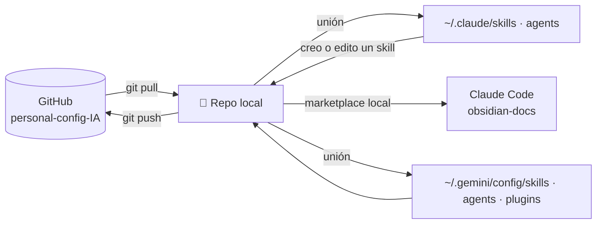

# 🧠 personal-config-IA

Mis **skills**, **agentes** y **plugins** para **Claude Code** y **Google Antigravity**, sincronizados en cualquier equipo con git.

```
personal-config-IA/
├── .claude-plugin/marketplace.json  → este repo es un marketplace de Claude Code ("personal-config-ia")
├── skills/                          → ~/.claude/skills  y  ~/.gemini/config/skills   (compartidos)
├── agents/
│   ├── claude/                      → ~/.claude/agents
│   └── antigravity/                 → ~/.gemini/config/agents
├── plugins/
│   └── obsidian-docs/               → un solo plugin para las dos herramientas:
│                                       Antigravity: ~/.gemini/config/plugins/obsidian-docs
│                                       Claude Code: obsidian-docs@personal-config-ia
├── instalar.cmd / instalar.ps1      ← Windows
├── sincronizar.cmd / sincronizar.ps1
├── instalar.sh / sincronizar.sh     ← macOS / Linux
└── README.md
```

## ⚙️ Cómo funciona

El instalador no copia archivos:

- **Skills y agentes:** crea **uniones de carpeta** (Windows) o **enlaces simbólicos** (macOS/Linux) desde las carpetas globales de cada herramienta hacia este repo.
- **Plugins en Antigravity:** una unión por plugin en `~/.gemini/config/plugins/<plugin>`.
- **Plugins en Claude Code:** registra este repo como **marketplace local** e instala sus plugins. Un marketplace local se carga directo desde la carpeta, así que funciona igual que las uniones.



- Después de `git pull`, los cambios ya están activos en Claude y Antigravity (solo reinícialos).
- Si creas o editas un skill o un agente desde Claude o Antigravity, el cambio queda **dentro del repo**, listo para `commit`.
- Las uniones de carpeta **no** requieren permisos de administrador.

## 🚀 Equipo nuevo (una sola vez)

**Requisitos:** Git. Para el plugin `obsidian-docs`: Python 3.8+. Para que el instalador registre los plugins en Claude, el comando `claude` en el PATH.

```powershell
cd $HOME
git clone https://github.com/SebzSGC/personal-config-IA.git
cd personal-config-IA
.\instalar.cmd            # o doble clic en instalar.cmd
```

Para ver qué haría sin cambiar nada: `powershell -ExecutionPolicy Bypass -File .\instalar.ps1 -Simular`

> [!note] Si el equipo ya tiene skills o agentes propios
> El instalador los **incorpora al repo** (nunca sobrescribe lo que ya está en el repo) y te lo indica en «Para revisar». Haz `commit` + `push` para que queden en todos tus equipos.
> Lo que choca de nombre queda en `~/.claude/skills.respaldo-<fecha>` (o similar) para que decidas.

macOS / Linux: `./instalar.sh` (y `./instalar.sh --simular`).

**Claude Code a mano** (si `claude` no estaba en el PATH al instalar), dentro de Claude Code:

```
/plugin marketplace add C:\Users\<tú>\personal-config-IA
/plugin install obsidian-docs@personal-config-ia
```

## 🔄 Día a día

| Quiero… | Hago |
|---|---|
| Traer lo último a este equipo | `sincronizar.cmd` (hace `git pull` y reenlaza) |
| Guardar un cambio | `git add -A` → `git commit -m "feat(skills): agrega skill de informes"` → `git push` |
| Agregar un skill suelto (Claude y Antigravity) | Crea `skills/<nombre>/SKILL.md` (o créalo desde Claude/Antigravity) y haz commit |
| Agregar un agente | Archivo `.md` en `agents/claude/` o `agents/antigravity/` (el formato del encabezado es distinto en cada uno) |
| Agregar un plugin | Carpeta en `plugins/<nombre>/` con `plugin.json` (Antigravity) y/o `.claude-plugin/plugin.json` (Claude), agrégalo a `.claude-plugin/marketplace.json` y **vuelve a ejecutar** `instalar` |
| Quitar un plugin | Bórralo del repo y del marketplace y ejecuta `instalar`: el enlace sobrante se elimina solo |
| Ver el dashboard de la documentación | Doble clic en `_dashboard/generar-dashboard.cmd` **de tu repo de vaults** (ver `obsidian-docs`) |
| Dejar de usar el repo en un equipo | `instalar.ps1 -Desinstalar`: quita los enlaces, deja una copia local y desinstala los plugins de Claude |

### Convención de commits

`tipo(alcance): descripción` en minúscula, sin punto:

| Ejemplo | Cuándo |
|---|---|
| `feat(skills): agrega skill de conciliación bancaria` | Algo nuevo |
| `fix(obsidian-docs): corrige enlaces escapados en tablas` | Corrección |
| `docs(readme): explica instalación en macOS` | Solo documentación |
| `refactor(agents): separa revisor en dos agentes` | Reorganización |
| `chore(repo): actualiza gitignore` | Mantenimiento |

Para que git lo exija en cada commit (y bloquee secretos), instala los hooks del plugin:
```powershell
python plugins\obsidian-docs\skills\git-documentacion\scripts\git_vault.py instalar-hooks .
```

## 🧩 Qué hay aquí

| Elemento | Para qué | Funciona en |
|---|---|---|
| `plugins/obsidian-docs` | Documentar proyectos en Obsidian y mantenerlos al día (orquestador + reglas siempre activas), requerimientos e historias de usuario, git con commits claros, dashboard del repo de vaults, revisor independiente | Claude Code y Antigravity |

> El **dashboard** ya no vive aquí: está en la carpeta `_dashboard/` de tu repositorio de vaults (código React, plantilla y lanzadores). El plugin solo tiene el motor que lo genera.

## 🔐 Qué NO va en este repo

Solo configuración. **Nunca**: sesiones ni credenciales (`~/.claude.json`, `.credentials.json`, `oauth_creds.json`), historiales o transcripciones (`~/.claude/projects/`), tokens de servidores MCP ni archivos `.env`. El `.gitignore` bloquea los más comunes y los hooks detectan secretos antes del commit.

## 🛠️ Problemas frecuentes

| Síntoma | Solución |
|---|---|
| «La ejecución de scripts está deshabilitada» | Usa `instalar.cmd` (ya pasa `-ExecutionPolicy Bypass`) |
| Un skill no aparece | Reinicia Claude / Antigravity. Revisa que la carpeta tenga `SKILL.md` con `name` y `description` |
| Un plugin nuevo no aparece en Antigravity | Ejecuta otra vez `instalar`, recarga Antigravity (`Developer: Reload Window`) e inicia una **nueva conversación** |
| Un plugin no aparece en Claude Code | `/plugin` → pestaña **Errors**; o `claude plugin validate plugins/<nombre>` desde la terminal |
| `sincronizar` dice que no pudo hacer pull | Tienes cambios sin subir: `git status`, haz commit y vuelve a intentarlo |
| Moví el repo de carpeta | Ejecuta `instalar` desde la nueva ubicación: reemplaza los enlaces viejos. En Claude: `/plugin marketplace remove personal-config-ia` y vuelve a ejecutar `instalar` |
