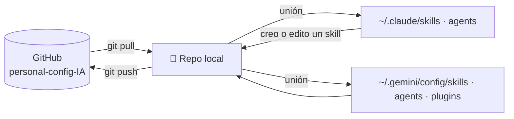

# 🧠 personal-config-IA

Mis **skills**, **agentes** y **plugins** para **Claude** y **Google Antigravity**, sincronizados en cualquier equipo con git.

```
personal-config-IA/
├── skills/                      → ~/.claude/skills  y  ~/.gemini/config/skills   (compartidos)
├── agents/
│   ├── claude/                  → ~/.claude/agents
│   └── antigravity/             → ~/.gemini/config/agents
├── plugins/
│   └── antigravity/
│       └── obsidian-docs/       → ~/.gemini/config/plugins/obsidian-docs
├── instalar.cmd / instalar.ps1      ← Windows
├── sincronizar.cmd / sincronizar.ps1
├── instalar.sh / sincronizar.sh     ← macOS / Linux
└── README.md
```

## ⚙️ Cómo funciona

El instalador no copia archivos: crea **uniones de carpeta** (Windows) o **enlaces simbólicos** (macOS/Linux) desde las carpetas globales de cada herramienta hacia este repo.



- Después de `git pull`, los cambios ya están activos en Claude y Antigravity (solo reinícialos).
- Si creas o editas un skill o un agente desde Claude o Antigravity, el cambio queda **dentro del repo**, listo para `commit`.
- Las uniones de carpeta **no** requieren permisos de administrador.

## 🚀 Equipo nuevo (una sola vez)

**Requisitos:** Git. Para el plugin `obsidian-docs`: Python 3.8+.

```powershell
cd $HOME
git clone https://github.com/SebzSGC/personal-config-IA.git
cd personal-config-IA
.\instalar.cmd            # o doble clic en instalar.cmd
```

Para ver qué haría sin cambiar nada: `powershell -ExecutionPolicy Bypass -File .\instalar.ps1 -Simular`

> [!note] Si el equipo ya tiene skills o agentes propios
> El instalador los **incorpora al repo** (nunca sobrescribe lo que ya está en el repo) y te lo indica en «Para revisar». Haz `commit` + `push` para que queden en todos tus equipos.
> Lo que choca de nombre queda en `~/.claude/skills.respaldo-<fecha>` (o similar) para que decidas.

macOS / Linux: `./instalar.sh` (y `./instalar.sh --simular`).

## 🔄 Día a día

| Quiero… | Hago |
|---|---|
| Traer lo último a este equipo | `sincronizar.cmd` (hace `git pull` y reenlaza) |
| Guardar un cambio | `git add -A` → `git commit -m "feat(skills): agrega skill de informes"` → `git push` |
| Agregar un skill | Crea `skills/<nombre>/SKILL.md` (o créalo desde Claude/Antigravity) y haz commit |
| Agregar un agente | Archivo `.md` en `agents/claude/` o `agents/antigravity/` |
| Agregar un plugin de Antigravity | Carpeta en `plugins/antigravity/<nombre>/` con su `plugin.json` y **vuelve a ejecutar** `instalar` |
| Quitar un plugin | Bórralo del repo y ejecuta `instalar`: el enlace sobrante se elimina solo |
| Dejar de usar el repo en un equipo | `instalar.ps1 -Desinstalar`: quita los enlaces y deja una copia local para que todo siga funcionando |

### Convención de commits

`tipo(alcance): descripción` en minúscula, sin punto:

| Ejemplo | Cuándo |
|---|---|
| `feat(skills): agrega skill de conciliación bancaria` | Algo nuevo |
| `fix(obsidian-docs): corrige enlaces escapados en tablas` | Corrección |
| `docs(readme): explica instalación en macOS` | Solo documentación |
| `refactor(agents): separa revisor en dos agentes` | Reorganización |
| `chore(repo): actualiza gitignore` | Mantenimiento |

Para que git lo exija en cada commit (y bloquee secretos), instala los hooks del plugin:
```powershell
python plugins\antigravity\obsidian-docs\skills\git-documentacion\scripts\git_vault.py instalar-hooks .
```

## 🧩 Qué hay aquí

| Elemento | Para qué | Funciona en |
|---|---|---|
| `plugins/antigravity/obsidian-docs` | Documentar proyectos en Obsidian, requerimientos e historias de usuario, git con commits claros | Antigravity |
| `agents/claude/revisor-documentacion.md` | Revisor independiente de la documentación del vault | Claude |

## 🔐 Qué NO va en este repo

Solo configuración. **Nunca**: sesiones ni credenciales (`~/.claude.json`, `.credentials.json`, `oauth_creds.json`), historiales o transcripciones (`~/.claude/projects/`), tokens de servidores MCP ni archivos `.env`. El `.gitignore` bloquea los más comunes y los hooks detectan secretos antes del commit.

## 🛠️ Problemas frecuentes

| Síntoma | Solución |
|---|---|
| «La ejecución de scripts está deshabilitada» | Usa `instalar.cmd` (ya pasa `-ExecutionPolicy Bypass`) |
| Un skill no aparece | Reinicia Claude / Antigravity. Revisa que la carpeta tenga `SKILL.md` con `name` y `description` |
| Un plugin nuevo no aparece | Ejecuta otra vez `instalar`, recarga Antigravity (`Developer: Reload Window`) e inicia una **nueva conversación**. |
| `sincronizar` dice que no pudo hacer pull | Tienes cambios sin subir: `git status`, haz commit y vuelve a intentarlo |
| Moví el repo de carpeta | Ejecuta `instalar` desde la nueva ubicación: reemplaza los enlaces viejos |
