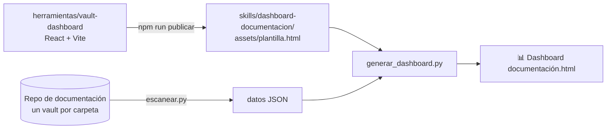

# 📊 Vault Dashboard · código fuente de la interfaz

Esta carpeta es el **código fuente** (React + Vite) de la interfaz del dashboard de documentación. No hace falta para usarlo: el plugin `obsidian-docs` trae la interfaz ya compilada y la llena con Python.



## ▶️ Generar el dashboard (uso normal)

No necesitas Node. Con Python 3.8+ y git:

- **Windows:** doble clic en `generar-dashboard.cmd` en la raíz de `personal-config-IA` (la primera vez pregunta la ruta del repositorio de documentación y la recuerda).
- **Con el agente:** *"Genera el dashboard de la documentación"* (skill `dashboard-documentacion`).
- **Terminal:** `py -3 plugins/antigravity/obsidian-docs/skills/dashboard-documentacion/scripts/generar_dashboard.py --repo "C:/ruta/repo" --abrir`

Opciones y configuración: ver el `SKILL.md` de `dashboard-documentacion`.

## 🛠️ Cambiar la interfaz

Requiere **Node.js 18+**.

```bash
cd herramientas/vault-dashboard
npm ci                                          # la primera vez
npm run datos -- --repo "C:/ruta/repo-de-docs"  # opcional: datos reales en src/data/datos.json (no se suben a git)
npm run dev                                     # vista en vivo en http://localhost:5173 (sin datos reales usa datos.ejemplo.json)
npm run publicar                                # compila y actualiza la plantilla del plugin
```

Después de `publicar`, haz commit de los cambios de `src/` **y** de `assets/plantilla.html` juntos, por ejemplo `feat(dashboard): agrega filtro por sprint`.

### Cómo llegan los datos

`index.html` tiene `<script id="datos-dashboard" type="application/json">__DATOS_DASHBOARD__</script>`. `generar_dashboard.py` reemplaza ese marcador por el JSON del escaneo; `src/datos.js` lo lee antes de montar la app. En desarrollo, si el marcador no se reemplazó, usa `src/data/datos.json` o `datos.ejemplo.json`.

Si cambias la forma de los datos, cámbiala en `escanear.py` (skill `dashboard-documentacion`) y en los componentes a la vez. Los estados y el avance de las historias vienen de `requerimientos.py`: no los redefinas aquí.

Estructura:

```
index.html             ← incluye el marcador de datos
scripts/publicar.mjs   ← compila y copia la plantilla al plugin
scripts/datos.mjs      ← escanea un repo real (con el escáner de Python) para npm run dev
src/datos.js           ← lee los datos del HTML (o de src/data en desarrollo)
src/App.jsx            ← página principal
src/components/        ← Grafo (d3-force), tarjetas, paneles, detalle de nota,
                          Requerimientos, Gantt, TableroKanban, DetalleHistoria
src/data/datos.ejemplo.json ← datos de ejemplo para desarrollo
```

## 🧭 Qué muestra

| Sección | Qué te dice |
|---|---|
| **Tarjetas de proyecto** | Notas, enlaces, tamaño, salud (0–100), insignias de problemas, último cambio, autores y actividad de 12 semanas |
| **Grafo** | Cómo se enlazan las notas. Tamaño = cuántas notas la enlazan. Naranja = nota que no existe. Anillo rojo = nota con problemas. Colorea por tipo o estado |
| **Cambios recientes** | Últimos archivos modificados según `git log`, con autor y mensaje del commit |
| **Autores** | Quién documenta y cuándo fue su último commit |
| **Notas más enlazadas** | Las notas centrales del proyecto |
| **Enlaces a notas inexistentes** | `[[enlaces]]` que apuntan a notas que no existen |
| **Notas huérfanas** | Notas que ninguna otra nota ni canvas enlaza |
| **Etiquetas** | Etiquetas del frontmatter y del texto |
| **Pendientes por confirmar** | Callouts `> [!question]` del vault |
| **Estado de la documentación** | Vigente / borrador / obsoleto y notas por tipo |
| **Problemas de calidad** | Frontmatter incompleto, sin `[!abstract]`, flujos sin diagrama, placeholders |
| **Cambios sin commit** | Archivos modificados en disco que no se han subido |

Además:
- 🔎 **Buscador** de notas en todos los proyectos (título, ruta y resumen).
- 🖱️ **Clic en una nota** (en el grafo o en cualquier lista) → panel con resumen, responsable, enlaces y botón **Abrir en Obsidian**.
- 🔗 La URL recuerda el proyecto y la nota abierta (`#p=Proyecto&n=nota`), así puedes compartir un enlace directo con quien tenga el archivo.
- 🌙 Modo oscuro automático y vista para celular.

### ¿Cómo se calcula la salud?
`100 − 40 × (% de notas con problemas) − 25 × (enlaces rotos / notas) − 20 × (% huérfanas) − 15 × (pendientes / notas)`.
🟢 ≥ 85 · 🟡 65–84 · 🔴 < 65.

## 📋 Pestaña Requerimientos

Si un proyecto tiene historias de usuario (creadas con el skill `requerimientos-historias` del plugin, en `15 - Requerimientos/`), aparece la pestaña **📋 Requerimientos**:

| Parte | Qué muestra |
|---|---|
| **Indicadores** | Avance general (ponderado por puntos), hechas, en curso, por iniciar, bloqueadas y vencidas |
| **Distribución** | Barra por estado: sin iniciar · por hacer · en progreso · en revisión · hecho · bloqueado |
| **📅 Cronograma** (tipo Jira) | Gantt agrupado por épica (plegable), barras con el % de avance, línea de **hoy**, flechas de **dependencias**, vencidas con borde rojo, bloqueadas rayadas. Zoom: Ajustar · Días · Semanas · Meses |
| **📋 Tablero** | Kanban por estado con prioridad, puntos, responsable, fecha fin y avance |
| **Detalle** (clic en cualquier historia) | Historia «Como / quiero / para», criterios de aceptación con su avance, tareas, dependencias navegables, bitácora y botón **Abrir en Obsidian** |
| **Épicas y alertas** | Avance por épica; alertas de vencidas, bloqueadas, hechas con criterios pendientes, dependencias sin terminar |

Filtros por épica, responsable y texto. El buscador de arriba también encuentra historias por ID (ej. `HU-003`).
Los datos salen del frontmatter de cada historia: si el agente (o tú) cambia el estado o marca criterios en Obsidian, el dashboard lo refleja al regenerarlo.

## 📝 Notas

Carpetas que se ignoran al escanear: las que empiezan por punto, `node_modules`, `vault-dashboard`, `_dashboard` y `dashboard`.

**Enlaces entre proyectos:** en modo `"proyecto"` cada carpeta es un vault independiente, así que un `[[enlace]]` a una nota de otro proyecto **cuenta como roto** (en Obsidian no abre). En modo `"repo"` sí es válido.

**Botón "Abrir en Obsidian":** en modo `"proyecto"` abre el vault con el nombre de la carpeta del proyecto. Para que funcione, cada proyecto debe haberse abierto al menos una vez en Obsidian con *Abrir carpeta como vault*.
