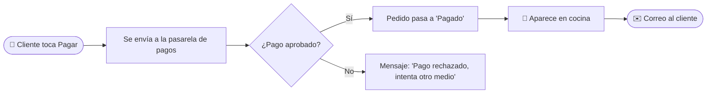
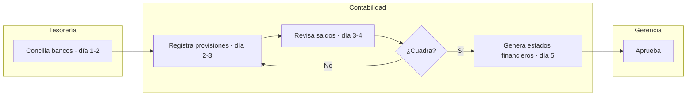

# Ejemplo resuelto · "Pedidos La 70"

Este es el **nivel de detalle esperado**. Muestra 3 notas completas de un proyecto ficticio (app de domicilios de un restaurante) y una cuarta de un proyecto no-software (proceso de cierre contable) para mostrar que el método aplica igual.

---

## Nota 1 · `10 - Visión general/Resumen ejecutivo.md`

````markdown
---
titulo: Resumen ejecutivo
tipo: resumen
estado: vigente
audiencia: [negocio]
responsable: Laura Gómez
actualizado: 2026-10-15
etiquetas: [tipo/resumen]
---

# 🎯 Resumen ejecutivo

> [!abstract] En pocas palabras
> **Pedidos La 70** es la app con la que los clientes del restaurante piden a domicilio y pagan en línea.
> Reemplazó los pedidos por WhatsApp, que se perdían o se anotaban mal.

## ❓ El problema
Antes, dos personas atendían WhatsApp en horas pico. Se perdían en promedio **15 pedidos por semana**
y 1 de cada 10 llegaba con errores (dirección o plato equivocado).

## ✅ La solución
El cliente arma su pedido en la app, paga con tarjeta o PSE y la cocina lo ve al instante en una pantalla.
Es como pasar de tomar pedidos en una servilleta a tener una comanda digital que nadie puede perder.

## 📈 Resultados (sept. 2026)
| Indicador | Antes | Ahora |
|---|---|---|
| Pedidos perdidos por semana | 15 | 0 |
| Pedidos con error | 10 % | 1,5 % |
| Tiempo para tomar un pedido | 6 min | 1 min (lo hace el cliente) |

## 🔗 Relacionado
- [[00 - Inicio]] · [[Flujo de pedido y pago]] · [[A tiempo (%)]]
````

---

## Nota 2 · `30 - Flujos y procesos/Flujo de pedido y pago.md`

````markdown
---
titulo: Flujo de pedido y pago
tipo: flujo
estado: vigente
audiencia: [negocio, tecnico]
responsable: Andrés Ríos
actualizado: 2026-10-15
frecuencia: cada pedido (~400/día)
etiquetas: [tipo/flujo, area/ventas]
---

# 🔄 Flujo de pedido y pago

> [!abstract] En pocas palabras
> El cliente elige platos, paga, y en menos de 10 segundos el pedido aparece en la pantalla de cocina
> y el cliente recibe un correo de confirmación.

| ▶️ Empieza | 🏁 Termina | ⏱️ Duración | 🔁 Frecuencia |
|---|---|---|---|
| Cliente toca **Pagar** | Pedido visible en cocina | < 10 s | ~400 al día |

## 🗺️ Vista general


## 🧭 Paso a paso
| # | Quién | Hace | Resultado |
|---|---|---|---|
| 1 | Cliente | Toca **Pagar** con el carrito lleno | Se abre la pasarela |
| 2 | [[Glosario#Pasarela de pagos\|Pasarela]] | Valida la tarjeta con el banco | Aprueba o rechaza |
| 3 | Servidor | Recibe el aviso ([[Glosario#Webhook\|webhook]]) y marca el pedido como pagado | Estado = `pagado` |
| 4 | Pantalla de cocina | Muestra el pedido con sonido | Cocina empieza a preparar |
| 5 | Servicio de correo | Envía confirmación | Cliente tranquilo |

## 💡 Ejemplo real
> [!example] Pedido #1042 · Ana · $38.500
> 12:31:05 Ana paga 2 bandejas paisas con su tarjeta débito.
> 12:31:08 La pasarela aprueba. 12:31:09 el pedido aparece en cocina.
> 12:31:11 Ana recibe "¡Tu pedido #1042 está en preparación!".

## 🛠️ ¿Y si algo sale mal?
| Situación | El cliente ve | El sistema hace | Qué hacer |
|---|---|---|---|
| Tarjeta rechazada | "Pago rechazado" | Mantiene el carrito 30 min | Nada, el cliente reintenta |
| Webhook no llega | Pantalla de "procesando" > 1 min | Reintenta cada 30 s, 5 veces | [[Runbook · Pagos sin confirmar]] |

> [!info]- Detalle técnico (secuencia)
> ```mermaid
> sequenceDiagram
>     autonumber
>     actor C as Cliente
>     participant App
>     participant API as API (Node.js)
>     participant PG as Pasarela
>     participant BD as PostgreSQL
>     C->>App: Pagar
>     App->>API: POST /pedidos/1042/pago
>     API->>PG: Crear transacción
>     PG-->>API: webhook APPROVED
>     API->>BD: UPDATE pedidos SET estado='pagado'
>     API-->>App: evento por WebSocket
> ```
> Código: `src/pagos/webhook.controller.ts` · Reintentos: `PAGOS_REINTENTOS=5`

## 🔗 Relacionado
- [[Servicio de pagos]] · [[Modelo de datos]] · [[ADR-002 Usar webhooks en vez de consultar estado]]
````

---

## Nota 3 · `10 - Visión general/Glosario.md` (fragmento)

````markdown
### Webhook
**Qué es:** Un aviso automático que un sistema le manda a otro cuando pasa algo.
**Analogía:** En vez de llamar al banco cada minuto a preguntar "¿ya pagaron?", el banco te manda un mensaje cuando pagan.
**En este proyecto:** La pasarela nos avisa por webhook cuando un pago se aprueba.
**Ver:** [[Flujo de pedido y pago]]
````

---

## Nota 4 · Proyecto no-software: `30 - Flujos y procesos/Cierre contable mensual.md`

````markdown
---
titulo: Cierre contable mensual
tipo: flujo
estado: vigente
audiencia: [negocio]
responsable: Contadora general
actualizado: 2026-10-15
frecuencia: mensual (días hábiles 1 a 5)
etiquetas: [tipo/flujo, area/contabilidad]
---

# 🔄 Cierre contable mensual

> [!abstract] En pocas palabras
> Durante los primeros 5 días hábiles de cada mes, Contabilidad revisa que todo lo que entró y salió
> el mes anterior esté registrado, y entrega los estados financieros a Gerencia.



| Actividad | Tesorería | Contabilidad | Gerencia |
|---|:-:|:-:|:-:|
| Conciliar bancos | **R** | A | I |
| Generar estados financieros | C | **R** | A |

> [!example] Cierre de septiembre 2026
> Banco Bogotá tenía una diferencia de $120.000: era una comisión no registrada.
> Se registró el día 2 y el cierre terminó el día 4 (un día antes de la meta).
````
