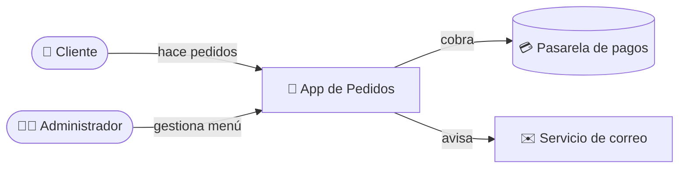
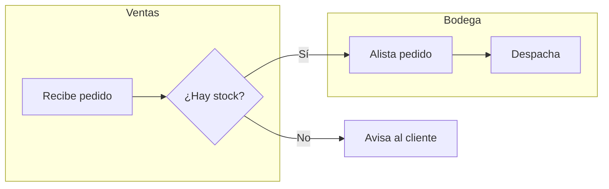
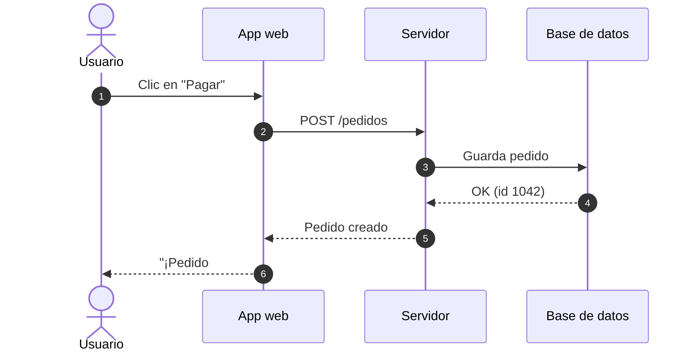
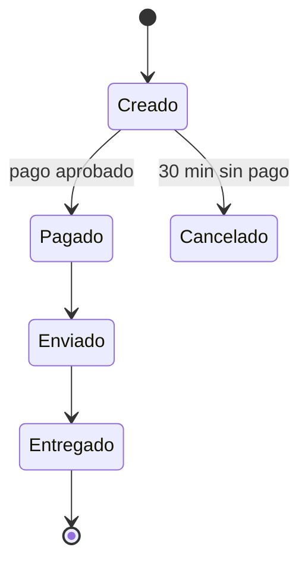
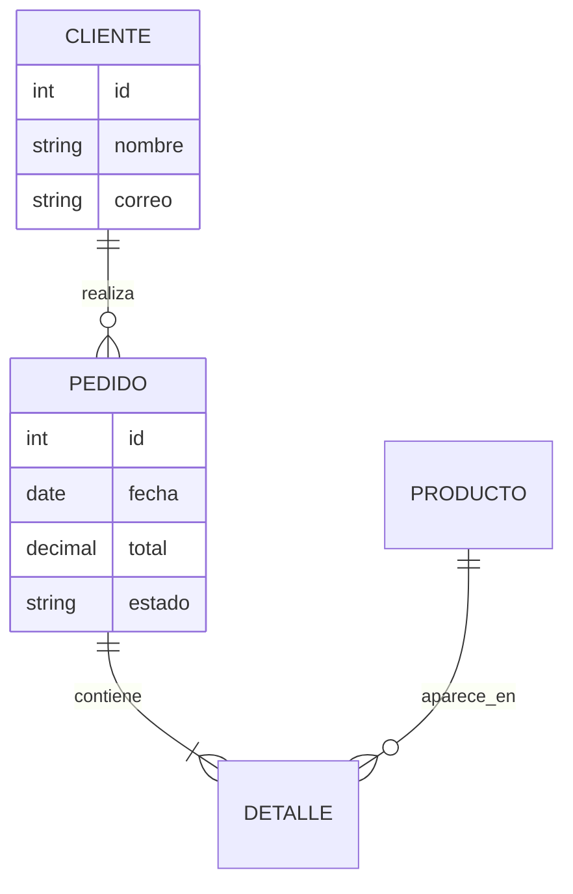

# Guía visual y de redacción

## 1. Redacción para dos audiencias

| Regla | ❌ Evitar | ✅ Preferir |
|---|---|---|
| Frases cortas (≤ 20 palabras) | "El sistema procede a efectuar la validación de las credenciales del usuario contra el proveedor de identidad mediante OAuth2." | "El sistema comprueba usuario y contraseña con [[Glosario#Proveedor de identidad\|el proveedor de identidad]]." |
| Voz activa | "El archivo es generado por el script." | "El script genera el archivo." |
| Analogías cotidianas | "La caché reduce latencia." | "La caché es como tener a mano los papeles más usados en el escritorio en vez de ir al archivo cada vez." |
| Números concretos | "Procesa muchos registros." | "Procesa unos 12.000 pedidos al día (pico: 2.300 entre 12 m y 2 p. m.)." |
| Resultado primero | "Para exportar, abra el menú, luego…" | "Obtendrás un Excel con las ventas del mes. Pasos: …" |

Estructura de toda nota:
1. Frontmatter
2. `# Título`
3. Callout `> [!abstract] En pocas palabras` (2-3 líneas sin jerga)
4. Diagrama (si aplica)
5. Contenido con encabezados `##` con emoji de sección
6. `## 🔗 Relacionado`

## 2. Emojis de sección (consistentes en todo el vault)

| Emoji | Sección | Emoji | Sección |
|---|---|---|---|
| 🎯 | Objetivo / para qué | ⚙️ | Cómo funciona |
| 👥 | Quién lo usa | 🧭 | Paso a paso |
| 🗺️ | Diagrama / mapa | 💡 | Ejemplo |
| 📥 | Entradas | 📤 | Salidas |
| ⚠️ | Riesgos / cuidado | 🛠️ | Solución de problemas |
| 📊 | Datos / métricas | 🔗 | Relacionado |

## 3. Callouts de Obsidian

```markdown
> [!abstract] En pocas palabras
> Resumen sin jerga para cualquiera.

> [!example] Ejemplo real
> Concreto, con datos del proyecto.

> [!tip] Consejo
> [!warning] Cuidado
> [!danger] Nunca hagas esto
> [!success] Resultado esperado
> [!question] Pendiente de confirmar
> [!note] Nota

> [!info]- Detalle técnico (clic para expandir)
> El guion después del tipo lo pliega. Úsalo para lo que solo le interesa al equipo técnico.
```

## 4. Diagramas Mermaid (Obsidian los renderiza nativamente)

Reglas: máx. ~15 nodos, etiquetas en lenguaje llano, dirección `LR` para procesos y `TD` para jerarquías, título en un comentario `%%`.

### Contexto del sistema (para todos)


### Proceso con áreas (carriles)


### Secuencia (quién habla con quién y en qué orden)


### Estados (ciclo de vida)


### Modelo de datos


### Otros útiles
- `gantt` → cronogramas · `timeline` → historia del proyecto · `journey` → experiencia del usuario
- `mindmap` → mapa conceptual para el Resumen ejecutivo · `pie` → distribución simple
- `quadrantChart` → priorización de riesgos (impacto vs probabilidad)

## 5. Canvas

Crea `Mapa del proyecto.canvas` (JSON Canvas) en la raíz del proyecto. Las rutas de `"file"` son relativas a la carpeta del proyecto (la raíz del vault), ej. `"10 - Visión general/Glosario.md"`. Grupos por carpeta, nodos tipo `file` apuntando a las notas, aristas con etiqueta del tipo de relación. Ver `ejemplo-canvas.canvas`. Colores: "1" rojo (riesgos), "2" naranja (operación), "3" amarillo (guías), "4" verde (visión), "5" cian (arquitectura), "6" morado (datos).

## 6. Tablas

Úsalas para comparar, listar parámetros o diccionarios de datos. Máximo 6 columnas. Primera columna = lo que se busca.

## 7. Bloques de código

Siempre con lenguaje (` ```bash `, ` ```sql `, ` ```dax `), y una línea antes explicando qué hace en llano. Incluye la salida esperada si ayuda.
