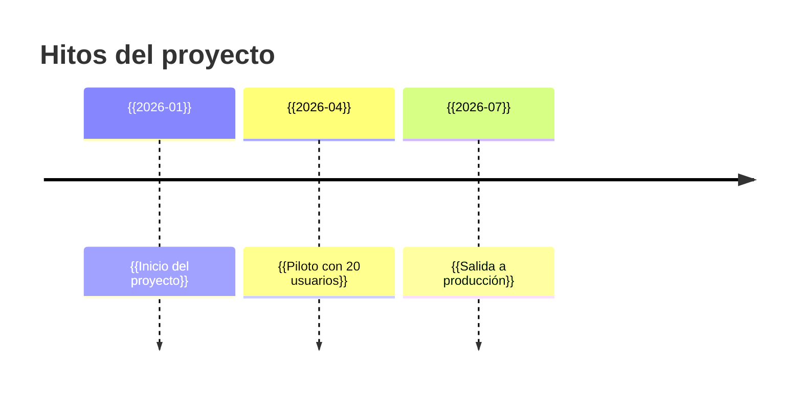

<!-- Este archivo contiene DOS plantillas. Crea dos notas separadas: "FAQ.md" e "Historial de cambios.md". -->

<!-- ===================== FAQ.md ===================== -->
---
titulo: Preguntas frecuentes
tipo: faq
estado: vigente
audiencia: [negocio, tecnico]
actualizado: "{{AAAA-MM-DD}}"
etiquetas: [tipo/faq]
---

# ❓ Preguntas frecuentes

> [!abstract] En pocas palabras
> Las dudas que más se repiten. Si tu pregunta no está, pregúntale a {{responsable}} y agrégala aquí.

## 👩‍💼 Para usuarios de negocio

> [!question]- {{¿Cada cuánto se actualizan los datos?}}
> {{Respuesta corta y directa. Enlace si hay más detalle: [[…]]}}

## 🛠️ Para el equipo técnico

> [!question]- {{¿Cómo corro el proyecto localmente?}}
> Ver [[Primeros pasos]].

<!-- ============ Historial de cambios.md ============ -->
---
titulo: Historial de cambios
tipo: cambios
estado: vigente
audiencia: [negocio, tecnico]
actualizado: "{{AAAA-MM-DD}}"
etiquetas: [tipo/cambios]
---

# 📝 Historial de cambios

> [!abstract] En pocas palabras
> Qué cambió, cuándo y qué significa para quien lo usa. Lo más reciente arriba.

## {{AAAA-MM-DD}} · v{{X.Y}}
- ✨ **Nuevo:** {{…}}
- 🐛 **Corregido:** {{…}}
- ⚠️ **Cambia para ti:** {{impacto en el usuario, en llano}}
