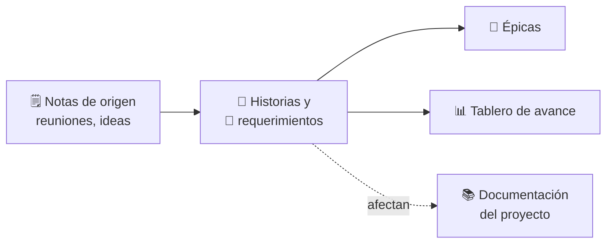

# 📋 Requerimientos

> [!abstract] Qué encontrarás aquí
> Qué se va a construir (historias de usuario y requerimientos), agrupado en épicas, y en qué va cada cosa.
> El avance al día está en **[[Tablero de avance]]**.

## 🗺️ Cómo está organizado

| Estado | Significa |
|---|---|
| ⚪ Sin iniciar | Identificada, aún no planificada |
| 🔵 Por hacer | Lista y planificada (tiene prioridad y fechas) |
| 🟡 En progreso | Alguien trabaja en ella |
| 🟣 En revisión | Construida, se están verificando los criterios |
| 🟢 Hecho | Todos los criterios de aceptación cumplidos |
| 🔴 Bloqueado | No puede avanzar (motivo en la historia) |
| ⚫ Descartado | Se decidió no hacerla (se conserva el registro) |

## 🧩 Épicas

| Épica | Objetivo |
|---|---|
| [[{{EP-01 Nombre}}|EP-01]] | {{…}} |

## 🗒️ Notas de origen
- [[{{AAAA-MM-DD Reunión}}]]

⬅️ Volver a [[00 - Inicio]]
