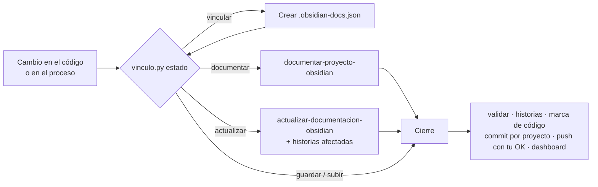

# 📚 obsidian-docs · Plugin para Claude Code y Google Antigravity

Documenta **cualquier proyecto** (software, Power BI/datos, infraestructura, automatizaciones, procesos de negocio) en un **Vault de Obsidian**, con:

- 🗂️ Estructura organizada (Diátaxis + índices MOC + numeración de carpetas)
- 🖼️ Diagramas Mermaid (contexto, secuencia, estados, ER, procesos con áreas, línea de tiempo) y un **Canvas** con el mapa del proyecto
- 🗣️ Doble nivel de lectura: resumen para no técnicos + detalle técnico plegable
- 💡 Ejemplos con datos concretos, glosario con analogías, FAQ, runbooks y decisiones (ADR)
- ✅ Validador automático (enlaces rotos, huérfanas, placeholders, secretos expuestos)
- 📋 Requerimientos e historias de usuario desde notas o reuniones, con épicas, criterios de aceptación, **tablero de avance** (sin iniciar · por hacer · en progreso · en revisión · hecho · bloqueado) y **cronograma Gantt**, que se actualizan solos al documentar
- 🔀 Gestión de git: commits atómicos por proyecto con mensajes claros (Conventional Commits en español), push seguro y hooks que bloquean secretos
- 🔁 **Ciclo automático**: un orquestador decide si hay que crear, actualizar o solo guardar, y una regla siempre activa hace que el agente actualice la documentación al terminar cada cambio de código
- 📊 **Dashboard** en un solo HTML (salud, grafo, cambios, cronograma y tablero de historias) que vive en tu **repositorio de vaults** y se genera solo con Python

Es **un solo plugin para las dos herramientas**: los skills, las reglas y los scripts son los mismos; solo cambia lo que cada una lee distinto (ver la tabla de abajo).

## 📦 Contenido

```
obsidian-docs/
├── plugin.json                          ← manifiesto de Antigravity
├── .claude-plugin/plugin.json           ← manifiesto de Claude Code (apunta a claude/)
├── skills/
│   ├── flujo-documentacion/             ← ORQUESTADOR: decide el camino y hace el cierre con git
│   │   ├── SKILL.md
│   │   ├── references/vinculo.md        ← formato de .obsidian-docs.json
│   │   └── scripts/vinculo.py           ← estado, vincular, marcar
│   ├── documentar-proyecto-obsidian/    ← crea la documentación desde cero
│   │   ├── SKILL.md
│   │   ├── references/                  ← estructura, guía visual, plantillas, ejemplo, checklist
│   │   └── scripts/validar_vault.py     ← validador (solo Python estándar)
│   ├── actualizar-documentacion-obsidian/ ← sincroniza tras cambios, registra ADR e incidentes
│   ├── auditar-vault-obsidian/          ← califica la documentación y propone mejoras
│   ├── requerimientos-historias/        ← notas → épicas e historias de usuario; avance, tablero y cronograma
│   │   ├── SKILL.md
│   │   ├── references/                  ← guía de historias (INVEST, criterios), plantillas
│   │   └── scripts/requerimientos.py    ← listar, siguiente-id, mover, sincronizar
│   └── git-documentacion/               ← pull, commits claros por proyecto, push seguro, hooks
│       ├── SKILL.md
│       ├── references/                  ← convención de commits, solución de problemas
│   │   └── scripts/git_vault.py         ← preparar, estado, validar-mensaje, escanear-secretos, instalar-hooks
│   └── dashboard-documentacion/         ← motor del dashboard del repo de vaults
│       ├── SKILL.md
│       └── scripts/                     ← escanear.py, generar_dashboard.py
├── rules/
│   ├── ciclo-documentacion.md           ← SIEMPRE activa: documentar y cerrar con git al terminar cada cambio
│   ├── estilo-obsidian.md               ← reglas de estilo al editar notas del vault
│   └── git-seguro.md                    ← prohíbe comandos destructivos y exige la convención de commits
├── agents/revisor-documentacion.md      ← revisor independiente (formato Antigravity)
├── hooks-opcionales/verificar_cierre.py ← hook «Stop»: recuerda documentar antes de terminar
└── claude/                              ← solo Claude Code
    ├── agents/revisor-documentacion.md  ← el mismo revisor, con el encabezado de Claude
    ├── hooks.json                       ← SessionStart (reglas) + Stop (verificar_cierre.py)
    └── reglas_sesion.py                 ← pasa rules/ a Claude al iniciar la sesión
```

### Qué usa cada herramienta

| Pieza | Antigravity | Claude Code |
|---|---|---|
| Skills (`skills/`) | ✅ tal cual | ✅ tal cual, como `obsidian-docs:<skill>` |
| Reglas (`rules/`) | ✅ nativas (`always_on` / `model_decision`) | ✅ el hook `SessionStart` las inyecta si el proyecto usa obsidian-docs |
| Agente revisor | `agents/` (`view_file`, `mainAgent`…) | `claude/agents/` (`Read, Grep, Glob, Bash`) |
| Hook de cierre | Opcional, se activa a mano | Activo por defecto (`claude/hooks.json`) |

> El agente está dos veces a propósito: el encabezado (herramientas, `mainAgent`, rutas) es incompatible entre las dos. **Si cambias las instrucciones del revisor, cámbialas en los dos archivos.**


## 🚀 Instalación

Con el repo `personal-config-IA`, `instalar` lo deja listo en las dos herramientas. A mano:

### Claude Code

```
/plugin marketplace add <carpeta de personal-config-IA>      (o SebzSGC/personal-config-IA desde GitHub)
/plugin install obsidian-docs@personal-config-ia
```

Reinicia Claude Code y verifica en `/plugin` que aparezcan los 7 skills, el agente y los hooks.

### Antigravity

**Opción A · Global (todos tus proyectos)** — enlaza o copia la carpeta `obsidian-docs` a:
- Windows: `%USERPROFILE%\.gemini\config\plugins\`
- macOS / Linux: `~/.gemini/config/plugins/`

**Opción B · Solo un proyecto** — copia la carpeta a `.agents/plugins/` en la raíz del proyecto.

**Opción C · CLI**
```bash
agy plugin install /ruta/a/obsidian-docs
agy plugin list
```

Reinicia Antigravity y verifica en **Customizations** que aparezcan los 7 skills, las 3 reglas y el agente.
El agente `revisor-documentacion` aparece en el selector de agentes porque tiene `mainAgent: true`; también lo puede invocar el agente principal como subagente (`subagent: true`).

> Requisitos: **Python 3.8+** (validador, historias, git y dashboard) y **Git**. No hace falta Node. En Windows los comandos usan `py -3` (o `python`); `python3` es para macOS/Linux.

## 🔁 Cómo funciona el ciclo



1. **Vincula** cada repositorio de código con su vault una sola vez (el agente lo propone la primera vez):
   `.obsidian-docs.json` en la raíz del código → `{"vault": {"proyecto": "Informe Junta"}}`; la ruta del repo de documentación de tu máquina queda en `~/.obsidian-docs.json`.
2. La regla **`ciclo-documentacion`** (siempre activa) hace que el agente, al terminar un cambio de código, siga el skill **`flujo-documentacion`**: actualiza las notas afectadas, mueve las historias, valida, hace el commit y te pide confirmación para el push.
3. `vinculo.py marcar` anota en `00 - Inicio.md` hasta qué commit de código está documentado, así la próxima vez solo se revisa lo nuevo.
4. Opcional: el hook de `hooks-opcionales/` le recuerda al agente documentar si intenta terminar con la documentación atrasada.

## 💬 Cómo usarlo (ejemplos de prompts)

| Quiero… | Escribe |
|---|---|
| Documentar desde cero | *"Documenta este proyecto en mi vault de Obsidian en `C:\Users\yo\Vault\Proyectos`"* |
| Documentar un proceso | *"Documenta el proceso de cierre contable mensual en Obsidian; los actores son Tesorería, Contabilidad y Gerencia"* |
| Documentar un modelo Power BI | *"Documenta el modelo de Power BI de este repositorio en Obsidian, con las medidas explicadas para gerencia"* |
| Actualizar tras cambios | *"Actualiza la documentación de Obsidian con los cambios de esta semana"* |
| Saber si la doc está al día | *"¿La documentación de este proyecto está al día?"* |
| Vincular un repo de código | *"Vincula este repositorio con el proyecto «Informe Junta» del vault en `C:\Users\yo\docs-bi`"* |
| Indicar dónde están tus vaults | *"Mis vaults están en el repo `C:\Users\yo\documentacion`"* (queda recordado) |
| Ver el dashboard | *"Genera el dashboard de la documentación"* · o doble clic en `_dashboard/generar-dashboard.cmd` del repo de vaults |
| Registrar una decisión | *"Registra en el vault la decisión de migrar de MySQL a PostgreSQL"* |
| Revisar calidad | *"Audita la documentación del proyecto en el vault"* |
| Crear historias desde notas | *"Con estas notas de la reunión crea las historias de usuario del proyecto App Encuestas: …"* |
| Pasar una nota del vault a historias | *"Convierte la nota «2026-09-01 Reunión con Gestión Humana» en historias de usuario"* |
| Cambiar el avance | *"La HU-003 ya está en pruebas"* · *"Bloquea la HU-006: TI no aprobó WhatsApp"* |
| Ver el estado | *"¿Qué está en progreso y qué está bloqueado en App Encuestas?"* |
| Preparar git (primera vez) | *"Prepara el repositorio git del vault en `C:\Users\yo\documentacion-invamer`"* |
| Subir cambios | *"Sube los cambios de la documentación"* · *"Haz commit y push"* |
| Traer cambios del equipo | *"Sincroniza el vault antes de empezar"* |
| Deshacer | *"Deshaz el último commit del Informe Junta"* |

### 📋 Cómo quedan los requerimientos en el vault

```
App Encuestas/
├── 00 - Inicio.md            ← se le agrega una línea: 📋 [[Requerimientos]]
├── 15 - Requerimientos/      ← carpeta nueva; el resto del vault no se toca
│   ├── Requerimientos.md     ← índice con épicas y su avance
│   ├── Tablero de avance.md  ← tablero por estado + cronograma Gantt + alertas
│   ├── Notas de origen/      ← actas e ideas tal como llegaron
│   ├── Épicas/               ← EP-01, EP-02…
│   └── Historias/            ← HU-001…, RF-001…, RNF-001…
```

El avance de cada historia sale de sus **criterios de aceptación marcados** (`- [x]`). Cuando pides *"actualiza la documentación"*, el agente revisa qué historias tocó el cambio, las mueve de estado, regenera el tablero y las referencia en el commit (`Refs: HU-003`).

### 🔀 Cómo quedan los commits

```
docs(informe-junta): agrega KPI de costo por unidad

Qué cambió:
- Nueva nota «Costo por unidad» con fórmula, ejemplo de septiembre y diagrama.
- «Flujo de generación mensual»: nueva sección «¿Y si algo sale mal?».

Por qué:
Gerencia pidió incluir el costo por unidad en el informe de octubre.
```

Un commit por proyecto, tipo (`feat`, `docs`, `fix`, `refactor`, `style`, `chore`, `revert`) y el proyecto entre paréntesis.
Así el historial de git y el dashboard cuentan qué cambió sin abrir los archivos.

Validar manualmente en cualquier momento (desde la carpeta del plugin):
```powershell
# Windows (si `py` no existe, usa `python`)
py -3 skills\documentar-proyecto-obsidian\scripts\validar_vault.py "C:\Users\yo\Vault\Proyectos\Mi proyecto"
```
```bash
# macOS / Linux
python3 skills/documentar-proyecto-obsidian/scripts/validar_vault.py "$HOME/Vault/Proyectos/Mi proyecto"
```

## 📊 Dashboard y repositorio de vaults

El dashboard vive en tu **repositorio de vaults** (el repo git con un vault por carpeta), en `_dashboard/`: interfaz compilada, código React y lanzadores. Este plugin solo trae el motor.

1. La primera vez dile al agente en qué repo están tus vaults (o lo pregunta él); queda en `~/.obsidian-docs.json` → `repoDocumentacion`.
2. *"Genera el dashboard"* → crea `_dashboard/Dashboard.html` en ese repo (no va a git).
3. Sin agente: doble clic en `_dashboard/generar-dashboard.cmd`. Ese lanzador busca este plugin en el equipo (Claude o Antigravity).

Detalles y cómo cambiar la interfaz: `_dashboard/README.md` del repo de vaults y el skill `dashboard-documentacion`.

## 🧩 Plugins de Obsidian recomendados (opcionales)

| Plugin | Para qué |
|---|---|
| **Dataview** | Índices automáticos por carpeta (las plantillas lo incluyen plegado) |
| **Templater** | Usar las plantillas de `90 - Recursos/Plantillas` al crear notas a mano |
| **Excalidraw** | Bocetos a mano alzada además de Mermaid |

Mermaid, Canvas, callouts y propiedades funcionan **sin plugins**.

## ✏️ Personalizar
- Plantillas → `skills/documentar-proyecto-obsidian/references/plantillas/`
- Estructura de carpetas → `references/estructura-vault.md`
- Estilo y emojis → `references/guia-visual.md` y `rules/estilo-obsidian.md`
